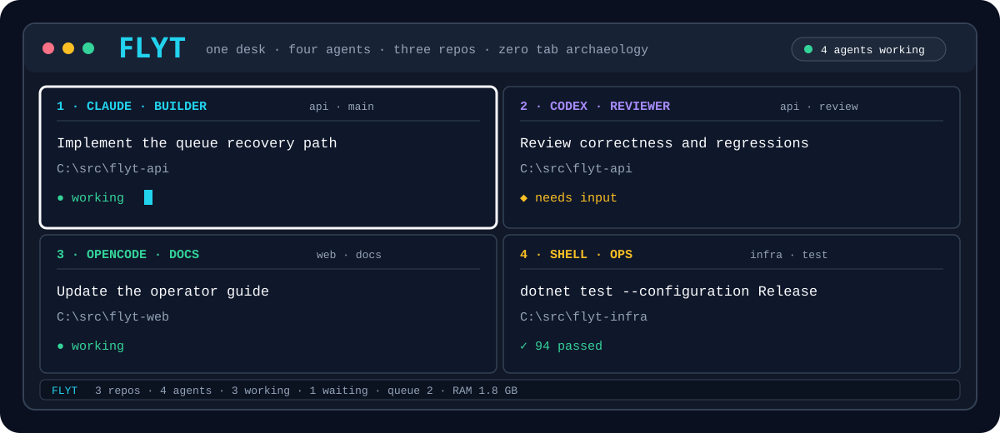

<p align="center">
  
</p>

<h1 align="center">Flyt</h1>

<p align="center">
  A Windows-first cockpit for Claude Code, Codex, OpenCode, and PowerShell.<br>
  Keep several coding sessions in one Desk, even when the work spans multiple repositories.
</p>

<p align="center">
  <a href="https://github.com/Pilvik1/Flyt/actions/workflows/ci.yml"></a>
  <a href="LICENSE"></a>
  
  
  
</p>

> **Status:** beta. Desk mode works and is release-gated. Mission mode has an
> end-to-end beta path; target-host pilot evidence is still pending.

## Why Flyt exists

One coding agent is easy to keep track of. Four agents, a shell, and three repositories
usually become a wall of tabs called "PowerShell 7". Flyt puts those sessions in one
Desk and records what each pane is doing.

- Open 1–10 Claude, Codex, OpenCode, or PowerShell panes in any mix.
- Start each pane in its own repository or working directory.
- See the role, task, provider, repo, branch, queue, and attention state for every pane.
- Jump, zoom, send, restart, hand off, inspect, and recover from the keyboard.
- Restore pane identities, queues, focus, and recent failures from local SQLite state.
- Preview broad sends and require approval for protected actions.

psmux handles the terminal panes. Flyt keeps track of what they are for, where they
belong, and how to bring them back after a restart. It is not the glamorous part of
the agent stack, but it is useful the next morning.

## Five-minute start

### Requirements

- Windows 11
- PowerShell 7
- [psmux 3.4.0+](https://github.com/psmux/psmux)
- at least one provider CLI: Claude Code, OpenAI Codex, or OpenCode

Flyt releases are self-contained; the .NET SDK is only needed for development.

### Install

Download and inspect the installer before running it:

```powershell
$installer = Join-Path $env:TEMP 'install-flyt.ps1'
Invoke-WebRequest https://raw.githubusercontent.com/Pilvik1/Flyt/main/scripts/install.ps1 `
  -OutFile $installer
pwsh -NoProfile -File $installer -InstallPsmux
Remove-Item $installer
```

For pre-public testing from the private repository, authenticate GitHub CLI and fetch
the same script through the API:

```powershell
gh auth login
$installer = Join-Path $env:TEMP 'install-flyt.ps1'
gh api repos/Pilvik1/Flyt/contents/scripts/install.ps1 `
  -H 'Accept: application/vnd.github.raw' | Set-Content $installer
pwsh -NoProfile -File $installer -InstallPsmux
Remove-Item $installer
```

The installer detects x64/ARM64, verifies the release SHA-256, installs for the
current user, imports the PowerShell module, and rolls back failed upgrades.

### Configure a Desk

Run this in any repository:

```powershell
flyt doctor
flyt desk configure --path .
```

The guided flow asks for:

1. a Desk name;
2. **1–10 panes**;
3. Claude, Codex, OpenCode, or Shell for each pane;
4. the repository/working directory for each pane;
5. role and task labels; and
6. whether to open immediately.

Paths accept `.`, `..`, `~`, an absolute path, or a recent-repository number. Flyt
previews the complete pane-to-repository map before saving `.flyt/desk.json`.

Scripted configuration works too:

```powershell
flyt desk configure --path . --name product-review --panes 4 `
  --providers claude,codex,opencode,shell `
  --working-directories 'C:/src/api|C:/src/api|C:/src/web|C:/src/infra' `
  --open
```

## Cockpit controls

| Keys | Action |
|---|---|
| `Alt+1…9`, `Alt+0` | Jump to panes 1–10 |
| `Ctrl+b`, `A` | Next pane needing attention |
| `Ctrl+b`, `Z` | Zoom/unzoom the current pane |
| `Ctrl+b`, `n` or `N` | Add a pane to the running Desk |
| `Ctrl+b`, `X` or `x` | Close the active pane after a warning |
| `Ctrl+b`, `S` | Send text to selected panes |
| `Ctrl+b`, `R` | Restart the active pane |
| `Ctrl+b`, `H` | Create a structured handoff |
| `Ctrl+b`, `Q` | Inspect or dispatch the queue |
| `Ctrl+b`, `L` | View recent output |
| `Ctrl+b`, `O` | Open the action menu |
| `Ctrl+b`, `?` | Show the shortcut sheet |

Useful commands:

```powershell
flyt desk open --path .
flyt desk status
flyt desk add-pane --name product-review --provider codex --pane reviewer-2
flyt desk remove-pane --name product-review --pane reviewer-2
flyt desk send --name product-review --role reviewer `
  --text 'Review the current diff' --yes
flyt desk recover --name product-review
flyt desk history --name product-review --search failure
```

The complete walkthrough lives in the [operator guide](docs/operator-guide.md),
with deeper cockpit behavior in [Desk cockpit](docs/desk-cockpit.md).

## What works today

### Desk mode

- adaptive one-to-ten-pane psmux layouts;
- dynamic pane addition and guarded removal while a Desk is running;
- first-class Claude, Codex, OpenCode, and shell providers;
- multi-repository templates and provider resume identities;
- status reconciliation, pane focus, restart, log capture, and re-adoption;
- targeted multiline send with recipient previews;
- resource-gated queues, handoff bundles, failure receipts, and history;
- Windows notifications plus terminal fallbacks;
- ASCII, `NO_COLOR`, high-contrast, and small-terminal handling; and
- guided target-host acceptance with redacted receipts.

### Mission mode

Mission mode now runs one bounded path end to end:

`approved plan → isolated builder worktree → independent review → deterministic verification → operator-approved integration`

Attempts, timeouts, review verdicts, changed paths, diff fingerprints, and verification
output are persisted locally. Flyt blocks stale approvals, empty diffs, changed evidence,
known secret patterns, ambiguous reviews, and interrupted runs. It can prepare a commit,
push, and draft PR only through an explicit `mission integrate` command; merge stays manual.

Codex Missions use the typed app-server protocol by default. The older bounded
`codex exec` path remains available through `FLYT_CODEX_TRANSPORT=exec` while the target
Windows host finishes live acceptance.

This is still beta software. The remaining proof is one live app-server turn on the target
Windows host plus five real Missions across two weeks, tracked in the [roadmap](roadmap.md).

## Architecture

```text
PowerShell module / flyt CLI
              │
    deterministic controller
      ┌───────┼────────┐
      │       │        │
  providers  Git     psmux
      │       │        │
      └───────┼────────┘
              │
      SQLite event ledger
```

Terminal output is useful evidence, but it is not the source of truth for a Mission.
Models can propose and execute work. They cannot approve protected actions or mark
their own work as verified.

Read [architecture.md](architecture.md) and the decisions in [docs/decisions](docs/decisions/).

## Privacy and security

Flyt has no telemetry and no hosted backend. Recovery data stays on the machine:
repository paths, provider session IDs, launch commands, queue payloads, events,
plans, and bounded failure output. Failure text is redacted on a best-effort basis
before it is stored, and Flyt keeps only the latest 20 receipts per Desk.

The provider CLIs still follow their own network and data policies. Putting Claude,
Codex, or OpenCode in a Flyt pane does not make it local.

Read [PRIVACY.md](PRIVACY.md) and [SECURITY.md](SECURITY.md) before sharing state,
receipts, screenshots, or handoffs.

## Build from source

Requires the .NET 10 SDK.

```powershell
dotnet restore Flyt.slnx
dotnet build Flyt.slnx --configuration Release --no-restore
dotnet test Flyt.slnx --configuration Release --no-build
dotnet run --project src/Flyt.Cli -- doctor
```

For the PowerShell surface:

```powershell
Import-Module ./powershell/Flyt/Flyt.psd1 -Force
$env:FLYT_EXE = (Resolve-Path ./src/Flyt.Cli/bin/Release/net10.0/flyt.exe)
Test-FlytEnvironment
```

`FLYTV1_EXE`, `FLYTV1_STATE_DIR`, and the old `%LOCALAPPDATA%\FlytV1` state folder
remain supported for existing installations. New setups use `FLYT_EXE`,
`FLYT_STATE_DIR`, and `%LOCALAPPDATA%\Flyt`.

## Release evidence

Every release runs the build and tests on Ubuntu and Windows. The Windows job also
opens a real ten-pane psmux Desk and checks multi-repository paths, completion,
actions, stop/reopen, package installation, and recovery after the psmux session is
removed underneath Flyt.

Release assets include:

- self-contained x64 and ARM64 ZIPs;
- SHA-256 sidecars;
- an SPDX software bill of materials (SBOM);
- bundled third-party license and notice texts; and
- GitHub provenance attestations for releases built after publication.

Authenticated provider resume, visual quality, popup ergonomics, and visible Windows
notifications remain target-machine checks:

```powershell
flyt doctor --interactive --template default
```

## Inspiration

Two projects helped shape Flyt:

- [lemonsaurus/agency](https://github.com/lemonsaurus/agency), an agent orchestration
  panel built for ultrawide, multi-agent work; and
- [asheshgoplani/agent-deck](https://github.com/asheshgoplani/agent-deck), a terminal
  session manager for multiple coding-agent CLIs.

Flyt is not a fork of either project, and no source code was copied. Agency showed
what a multi-agent operating surface could feel like; Agent Deck showed how useful a
small terminal session manager can be. Flyt takes that idea into a Windows/PowerShell
setup with psmux, local state, multi-repository Desks, and explicit approval gates.

## Contributing

Issues and pull requests are welcome. Start with [CONTRIBUTING.md](CONTRIBUTING.md)
and follow the [CODE_OF_CONDUCT.md](CODE_OF_CONDUCT.md). Support boundaries live in
[SUPPORT.md](SUPPORT.md); security reports belong in GitHub's private vulnerability
reporting flow described in [SECURITY.md](SECURITY.md).

## License

[MIT](LICENSE) © 2026 Håkon Pilvik.
